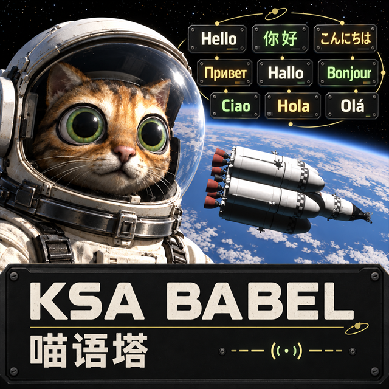

# KSA Babel · 喵语塔

[English](../../README.md) · [简体中文](README.zh-CN.md) · [日本語](README.ja-JP.md) · [Русский](README.ru-RU.md) · [Deutsch](README.de-DE.md) · [Français](README.fr-FR.md) · [Italiano](README.it-IT.md) · [Español](README.es-ES.md) · [Português (Brasil)](README.pt-BR.md)

<p align="center"></p>

Un framework di localizzazione multilingue per **Kitten Space Agency**, caricato tramite StarMap. KSA Babel fornisce pacchetti di lingua, un menu per scegliere la lingua nel gioco, adattamenti della visualizzazione e un sottoinsieme di caratteri condiviso. Non sostituisce l’eseguibile o le risorse del gioco.

KSA Babel è un progetto multilingue organizzato separatamente a partire da [KSA-CHINESE](https://github.com/kuxiaowo/KSA-CHINESE). La versione attuale è la **versione stabile 0.2.2**, compatibile soltanto con **KSA 2026.10.19.5638 su Windows x64** e con le impronte dei file verificate; il caricatore utilizzato è **StarMap 0.4.8**.

**Revisione e modalità inglese:** l’autore ha confermato personalmente soltanto la traduzione in cinese semplificato. Giapponese, russo, tedesco, francese, italiano, spagnolo e portoghese brasiliano sono stati tradotti e revisionati da GPT nel contesto di KSA, usando la terminologia aerospaziale di KSP come riferimento; manca una revisione indipendente di madrelingua. Parte delle traduzioni giapponesi iniziali deriva da KsaUiLanguages sotto MIT, con attribuzioni conservate. La modalità inglese mostra il testo inglese originale di KSA e mantiene il menu `Language` aggiunto dalla mod. Gli 11 modelli dinamici servono alla composizione multilingue e al ritorno all’originale, non indicano 11 testi inglesi riscritti.

**Edizione cinese:** [KSA Chinese / KSA-CHINESE](https://github.com/kuxiaowo/KSA-CHINESE), ID `KsaChinese`, offre inglese e cinese semplificato. La versione attuale è [v0.1.6](https://github.com/kuxiaowo/KSA-CHINESE/releases/tag/v0.1.6), archivio standard `KsaChinese-0.1.6.zip`, per i file verificati di KSA 2026.10.19.5638 su Windows x64 e StarMap 0.4.8. Ha una propria [voce Borea](https://github.com/KSAModding/content-index/blob/main/listings/KsaChinese.toml). Babel è il mod indipendente con nove lingue, ID `KsaBabel`. Non attivare entrambe le mod nello stesso profilo.

## Lingue e ambito

English · 简体中文 · 日本語 · Русский · Deutsch · Français · Italiano · Español · Português (Brasil)

Le sette lingue aggiuntive coprono ciascuna **4.786 voci** dell’ambito cinese già revisionato, più **11 modelli di testo dinamico**. L’inglese usa i testi originali del gioco. La completezza delle voci **non equivale alla traduzione dell’intero gioco**. Le nuove traduzioni hanno ricevuto una revisione contestuale tramite IA, **senza una validazione indipendente da parte di madrelingua**. I vecchi registri delle modifiche, i testi delle librerie native e degli errori, le scritte nelle texture e alcuni stati dell’interfaccia restano fuori dall’ambito revisionato. I controlli stretti e le altre risoluzioni richiedono ancora verifiche visive più ampie.

L’ambito attuale comprende interfaccia, suggerimenti, componenti, sostanze e relativi stati fisici, strumenti e parte delle note di aggiornamento. Vengono conservati sigle dei modelli, unità, segnaposto, ID di risorse, controlli e salvataggi, dati delle enumerazioni e nomi personalizzati dai giocatori. Le versioni sconosciute vengono rifiutate per sicurezza; in assenza di una traduzione viene mostrato il testo originale. Il sottoinsieme Noto Sans SC copre i caratteri censiti, ma non garantisce qualsiasi nome scelto dai giocatori né tutte le forme regionali dei glifi giapponesi.

## Installazione

Scarica i file dalle [release di KSA Babel](https://github.com/kuxiaowo/KSA-Babel/releases). I pacchetti 0.2.2 sono versioni stabili.

- **Con StarMap/Borea già installato:** usa `KsaBabel-0.2.2.zip`; inserisci la cartella `KsaBabel` nella cartella `mods` del profilo scelto e abilita la mod. Consulta [l’installazione standard](../../README-生态安装.md).
- **Con il launcher incluso:** estrai `KsaBabel-0.2.2-5638-Portable.zip` nella cartella che contiene `KSA.exe`, quindi avvia `KsaBabel/KsaBabelLauncher.exe`. Consulta [l’installazione portatile](../../README-便携Mod.md). È richiesto il runtime .NET 10 x64.

Dalla versione 0.2.1, l’ID della mod, le cartelle di installazione e il prefisso degli archivi sono **`KsaBabel`**; l’assembly del plugin è `KsaBabel.dll` e il launcher portatile è `KsaBabel/KsaBabelLauncher.exe`. La lingua viene salvata in `KsaBabel/settings.json` del profilo corrente. Al primo avvio, solo se il nuovo file non esiste, Babel importa un valore `locale` valido dal vecchio `KsaChinese/settings.json` dello stesso profilo. Le nuove impostazioni già esistenti non vengono sovrascritte e il vecchio file non viene modificato.

**Disabilita prima la vecchia mod:** Babel rifiuta l’attivazione finché `KsaChinese` è abilitata. Mantieni una sola copia attiva di Babel e non conservare contemporaneamente `Content/KsaBabel` e `mods/KsaBabel` nel profilo. Esegui un backup dei profili esistenti prima della migrazione. Nessun salvataggio personale viene incluso o spostato automaticamente; l’importazione delle impostazioni non cerca in altri profili.

[L’annuncio su Ahwoo](https://forums.ahwoo.com/forums/kitten-space-agency/mod-releases/ksa-babel-0-2-1-nine-language-localization-preview-for-ksa-5638.1454/) è stato pubblicato e la [PR #227 del catalogo Borea](https://github.com/KSAModding/content-index/pull/227) è stata unita. Consulta il [registro di pubblicazione](../../reports/community-publication-20261024.md) per lo stato dell’elaborazione della release e della verifica dello snapshot pubblico. La voce KsaChinese esistente e la versione v0.1.6 appartengono al progetto separato dedicato al cinese. KSA Babel 0.2.2 è una versione stabile, disponibile nel canale stable predefinito. Le sette traduzioni aggiuntive attendono ancora una revisione indipendente da parte di madrelingua.

Per migrare tramite Borea, esegui un backup del profilo e rimuovi la vecchia mod KsaChinese dall’istanza prima di installare Babel. Il conflitto nel catalogo blocca l’installazione anche se la vecchia mod è disattivata. Conserva i dati del profilo.

## Compilazione e validazione

Usa l’SDK .NET 10, una copia legalmente installata della versione esatta del gioco supportata e [StarMap 0.4.8](https://github.com/StarMapLoader/StarMap/releases/tag/0.4.8). Inserisci i file del caricatore in `.tools/StarMap-0.4.8`, oppure specifica `-LoaderDir`. Gli script Python richiedono Python 3; si preferisce conda.

```powershell
python scripts/build_multilingual.py --check
.\scripts\build.ps1 -GameDir 'D:\Games\Kitten Space Agency' -Validate
python scripts/package_mod.py
python scripts/package_portable.py
```

`KSA_GAME_DIR` può fornire il percorso locale del gioco al posto di `-GameDir`. I file binari del gioco, `.tools`, i profili locali e i risultati della compilazione sono ignorati da Git. Un clone appena creato non contiene il gioco, il caricatore, il decompilatore, i dati di ingresso degli audit o i dizionari di riferimento di KSP. Gli script facoltativi per gli audit storici richiedono i rispettivi dati locali, preparati separatamente.

Le decisioni di traduzione si trovano in `translations/multilingual/<locale>/*.jsonl`. `build_multilingual.py` verifica ID, provenienza, stato della revisione, segnaposto e marcatori rispetto alla base revisionata; i pacchetti incompleti o non aggiornati vengono rifiutati. La creazione degli archivi richiede anche una validazione locale riuscita e corrispondente alla compilazione, con sorgenti e risorse invariati. La CI controlla i dati portabili e il font; non può eseguire la compilazione che richiede una copia del gioco con licenza né validare il funzionamento durante il gioco.

Il font generato è già incluso. Per ricostruirlo servono fontTools e `.tools/NotoSansSC-variable.ttf`, il cui SHA-256 deve corrispondere a quello indicato in [FONT-SOURCE](../../assets/KsaBabel/FONT-SOURCE.txt); le modifiche alla sorgente richiedono una revisione. L’identità del download di StarMap e le licenze di terze parti sono documentate in [THIRD_PARTY](../../THIRD_PARTY.md).

## Evidenze e contributi

- [Ambito e verifica delle nove lingue](../../reports/0.2.0-九语种翻译与验证.md)
- [Origine del progetto e impronte dei file importati](../../reports/project-origin.json)
- [Note sulla migrazione e sulla pubblicazione](../../reports/KSA-Babel-项目迁移与公开验证.md)
- [Verifica ID e gestore 0.2.1](../../reports/0.2.1-独立ID与管理器验证.md)

I rapporti 0.1.x descrivono il progetto originale KSA Chinese e le sue compilazioni storiche. Sono conservati per documentare la provenienza, non come prova di precedenti pubblicazioni o inserimenti di Babel in un indice. Le evidenze dell’interfaccia grafica sono limitate alla scena di test registrata, ai cambi di lingua, alle schermate delle impostazioni e dell’HUD e ad aree fisse delle immagini contenenti valori numerici; non costituiscono una validazione visiva esaustiva.

I contributi devono indicare la lingua, il testo inglese originale, il contesto nel gioco e la formulazione proposta. La revisione da parte di madrelingua è particolarmente utile. Lo sviluppo e i commit seguono **`developing → pull request → main`**.

## Licenza

Codice e traduzioni realizzate per il progetto: **MIT**, mantenendo gli avvisi di copyright di KSA Chinese e KsaUiLanguages. Font: **SIL OFL 1.1**. Il pacchetto portatile include StarMap e Harmony con le rispettive licenze MIT. Consulta [LICENSE](../../LICENSE), [LICENSES](../../LICENSES) e [THIRD_PARTY](../../THIRD_PARTY.md).

Le risorse dei giochi KSA e KSP, i dizionari originali, i sorgenti decompilati e i dati personali non vengono distribuiti. KSP è stato usato come riferimento terminologico locale; il suo dizionario completo non è un dato di ingresso del prodotto né fa parte della release.
